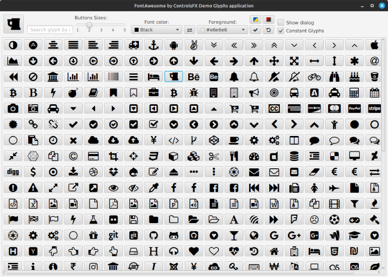
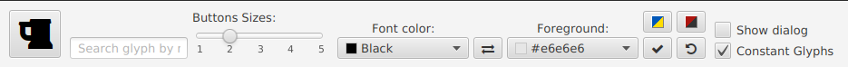

## FontAwesome Glyphs Demo application
### _ControlsFX FontAwesome Glyph viewer for JavaFX developers_

[](https://openjdk.org/) [](https://openjfx.io/) [](https://controlsfx.github.io) [](#)

🇺🇦 [Українська версія](README_ua.md)

### 💡 Purpose
To demonstrate how ControlsFX FontAwesome Glyphs can be used: all 593 glyphs on one page, with their names and Unicode codes, so you can quickly find the right icon and copy its name into your code.

### 📃 Features
- [Glyphs field](#GlyphsField) – all glyphs on one page with name and Unicode code in a tooltip
- [Search glyphs by name](#Search) with autocompletion
- [Demo button](#DemoButton) – shows how the glyph looks on a button
- [Customizable colors](#Colors) – font and background colors, swap, UA and OUN UPA flag presets
- [Options](#Options) – info dialog and glyphs-per-row mode
- Linux and Windows

### ⭐ Advantages
- **Everything in one window** – no need to browse the FontAwesome site and map icon names to ControlsFX enum names.
- **Copy-ready names** – a right click copies the exact `FontAwesome.Glyph` name to the clipboard.
- **Ready-to-run distribution** – the release archive includes the JavaFX runtime, only Java 17+ is required.

### 📱 Screenshots
<table>
  <tr>
    <td align="center"></td>
    <td align="center"></td>
  </tr>
  <tr>
    <td align="center"><i>Main window (Linux)</i></td>
    <td align="center"><i>Toolbar</i></td>
  </tr>
</table>

### 📌 Using

#### Getting and launching<a id='Launch' />
**_Download the archive for your OS, unpack it and run the script._**
1. Download from the [Releases section](https://github.com/anrydas/glyps/releases) (or clone the repository and [build it](#Build)):
   - `FontAwesomeDemo_v.X.Y-win-distribute.zip` – for Windows
   - `FontAwesomeDemo_v.X.Y-linux-distribute.tar.gz` – for Linux
2. Unpack and run `run.cmd` (Windows) or `run.sh` (Linux).
   - The scripts use Java from `JAVA_HOME`, or `java` from `PATH` if `JAVA_HOME` is not set.
   - They can be started from any directory.

#### Glyphs field<a id='GlyphsField' />
**_All glyphs as buttons, row by row._**
- Hover a glyph to see its name and Unicode code (DEC / HEX), e.g. `INFO_CIRCLE: [61530] [F05Ah]`.
- **Click** – shows the glyph on the [Demo button](#DemoButton) (and the info dialog, if enabled).
- **Right click** – copies the glyph's name to the system clipboard.
- **Button sizes** slider (1–5) changes the glyphs' size.
- On Windows glyphs are shown as labels instead of buttons (rendering ~600 buttons lags there), so the appearance differs slightly.

#### Search glyphs by name<a id='Search' />
**_Start typing a glyph's name to find it._**
- Names are autocompleted; when the text matches a name exactly, the glyph is highlighted and scrolled into view.
- **Enter** – activates the selected / found glyph.
- **Esc** – clears the field and removes the Demo button.

#### Demo button<a id='DemoButton' />
**_Appears when a glyph is clicked or found and shows it as it looks on a button._**
- **Right click** – copies the glyph's name to the system clipboard.
- **Ctrl + Click** – removes the button.

#### Customizable colors<a id='Colors' />
**_Font and background colors of the glyphs field and the Demo button._**
1. **Font color** – glyph color picker.
2. **Colors exchange button** – swaps font and background colors.
3. **Background color** – glyph background color picker.
4. **Color buttons block**:
   - **Ukrainian flag colors** – yellow on blue.
   - **OUN UPA flag colors** – red on black.
   - **Apply current colors** – applies the colors selected in the pickers.
   - **Reset to default colors** – black on #e6e6e6 gray.

#### Options<a id='Options' />
**_Check boxes on the right of the toolbar._**
- **Show dialog** – shows a dialog with the glyph's name and Unicode code when a glyph is clicked.
- **Constant Glyphs** – if checked, each row keeps the same number of glyphs when the size changes; otherwise the number of glyphs per row depends on the size.

### 🚀 Building the application<a id='Build' />
Requirements: JDK 17+, Maven (or the bundled `mvnw`).
```shell
./mvnw package           # build, run tests and create distribution archives
./mvnw javafx:run        # run the application from sources
```
Archives appear in `target/`: `FontAwesomeDemo_v.X.Y-linux-distribute.tar.gz` and `FontAwesomeDemo_v.X.Y-win-distribute.zip`.

**Note:** the JavaFX runtime for the archives is taken from the `libs3rd/linux/lib`, `libs3rd/win/lib` and `libs3rd/win/bin` directories, which are not stored in the repository. Put a JavaFX SDK of the same version as `javafx.version` in `pom.xml` (21.0.2) there, otherwise the archives are built without JavaFX.

###### _Made by -=:dAs:=-_
